# DukaanShoot — AI model photos + a marketplace for small shops

A mobile-first PWA for Indian shopkeepers and their customers, in English, తెలుగు and हिंदी.

- **Sellers** photograph an item and get 4 AI model photos. Then they tap "Sell this item": the product goes live in their online shop, orders arrive in real time, and they move each order through New → Accepted → Packed → Shipped / Ready → Delivered.
- **Buyers** browse local shops without logging in. They search and filter, save favourites, and order with Cash on Delivery or Pay at Shop. A live status timeline tracks each order.

> **This is the DEMO build.** It runs with **zero configuration and zero cost**: "Demo as Seller" and "Demo as Buyer" accounts come with sample shops, products and orders, plus free demo photos and test-mode payments. Each real service (Supabase, Razorpay test mode, FASHN AI) switches on only when you add its keys.

| Roles & demo | Marketplace | Product | Cart | Order placed | Live timeline |
|---|---|---|---|---|---|
| 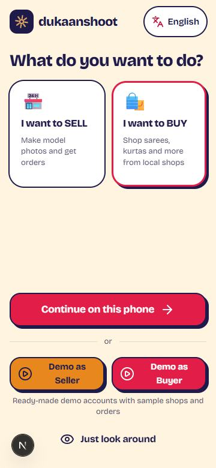 | 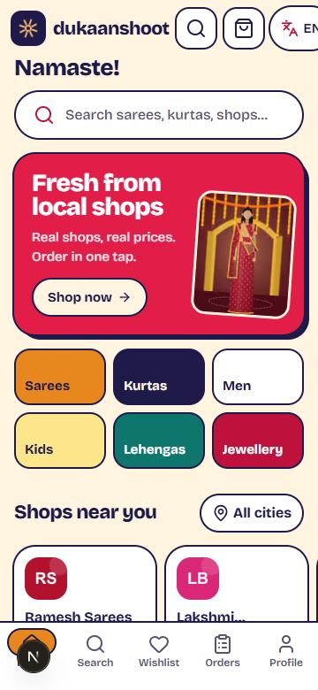 | 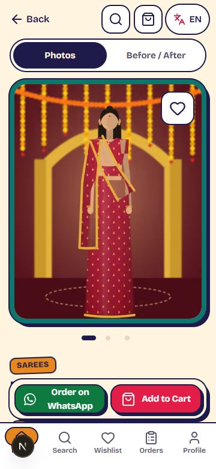 | 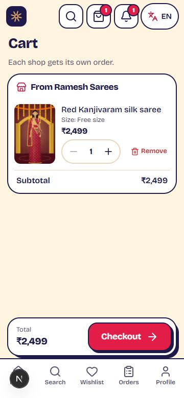 | 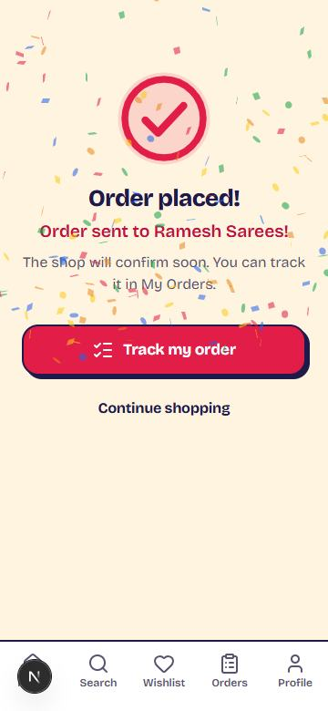 | 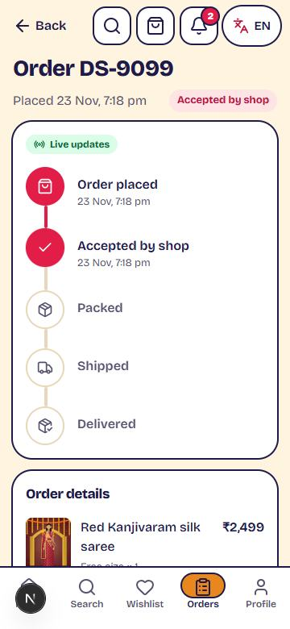 |

| Seller dashboard | New order (live) | AI photos | Photos "develop" | Products | Share shop + QR |
|---|---|---|---|---|---|
| 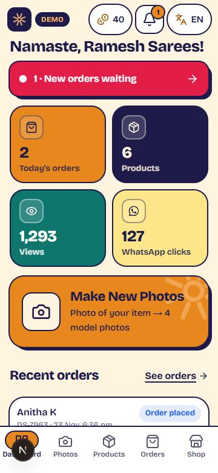 | 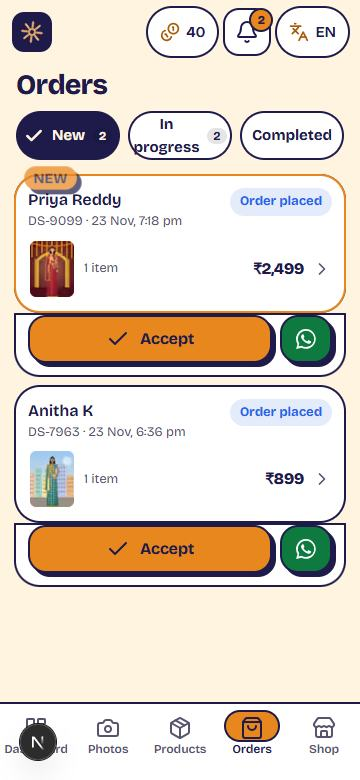 | 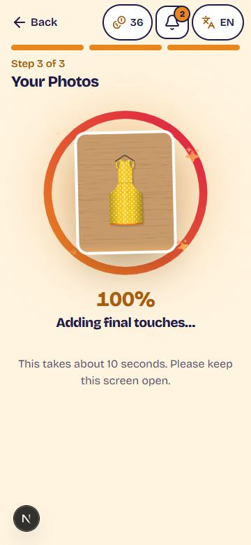 | 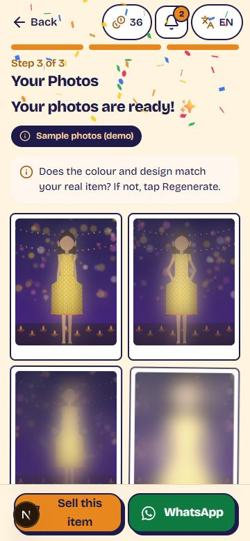 | 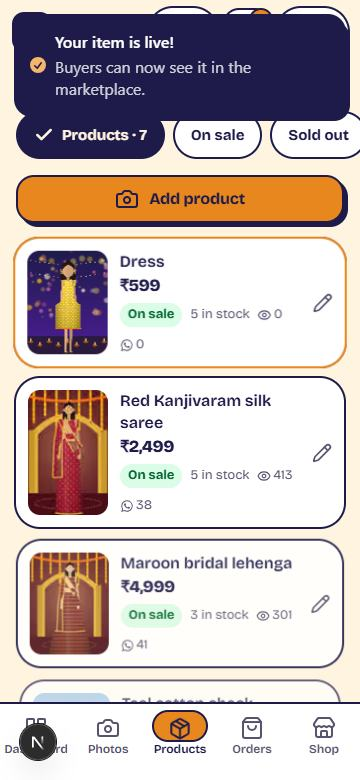 | 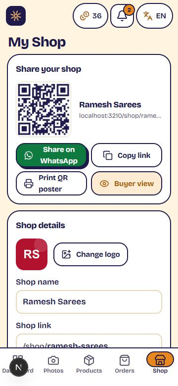 |

| Intro | Dark mode | Telugu |
|---|---|---|
| 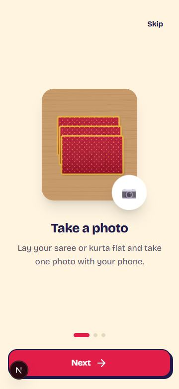 | 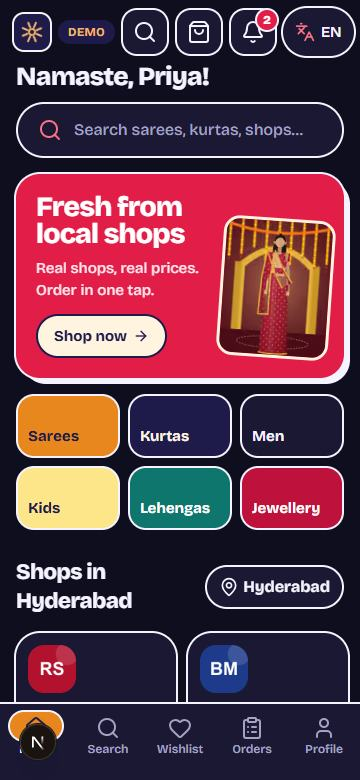 | 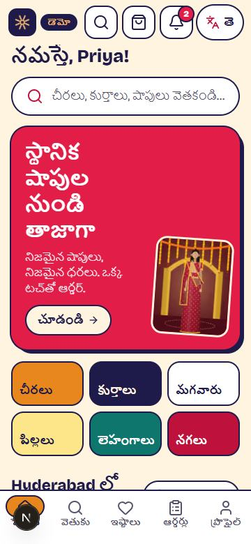 |

## Works on every screen

Built mobile-first for a 360px Android phone, then adapted at each breakpoint. Content is capped at 1440px on large screens.

| Width | Buyer | Seller |
|---|---|---|
| Phone < 768px | Bottom tab bar, header with search icon, one step per screen | Bottom tab bar |
| Tablet 768–1023px | Slim left icon rail (with tooltips), search bar in the header, 3-column grid, two-column product page | Icon rail |
| Laptop ≥ 1024px | Marketplace top navbar: logo, categories menu, big search ("/" focuses it), wishlist, slide-in cart drawer, profile, "Install app" | Collapsible left sidebar |

**Per screen:**
- **Product grid:** 2 → 3 → 4 → 5 → 6 columns as the screen widens.
- **Product page:** on laptops, thumbnails and a large photo with hover-zoom sit beside sticky details.
- **Search filters:** a bottom sheet on phones, a permanent left panel on laptops.
- **Cart and checkout:** sticky order summaries on laptops.
- **Photo studio:** on laptops one page holds upload (drag-and-drop or Ctrl+V paste), look options and live results.
- **Results:** 4 photos in a row with a larger before/after slider.
- **Seller dashboard:** stat cards in 1 → 2 → 4 columns; orders become a sortable table.
- **Dialogs:** bottom sheets on phones, centered dialogs on larger screens.

**Images:** next/image with `sizes` serves AVIF/WebP at the right width. Generated photos are kept as original + 1000px + 400px thumbnail, and grids use the thumbnail.

**Interaction:**
- Hover effects (card lift, photo zoom, second photo on hover) only run on devices that can hover.
- Long-press a product card on a phone to save it.
- Text sizes scale fluidly with `clamp()`.
- No screen scrolls sideways.

| Laptop marketplace | Product (hover zoom) | Cart drawer | Filters panel |
|---|---|---|---|
| 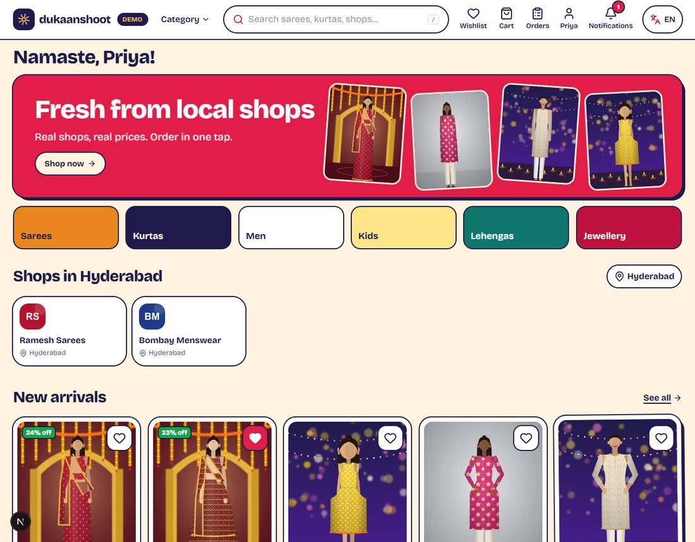 | 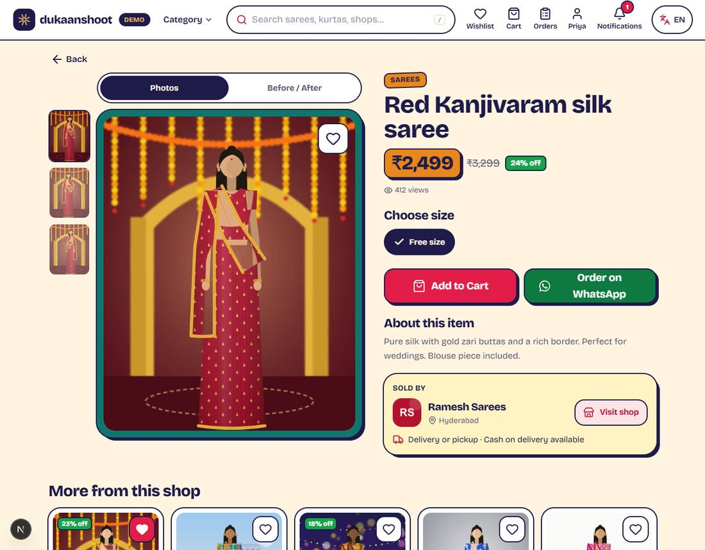 | 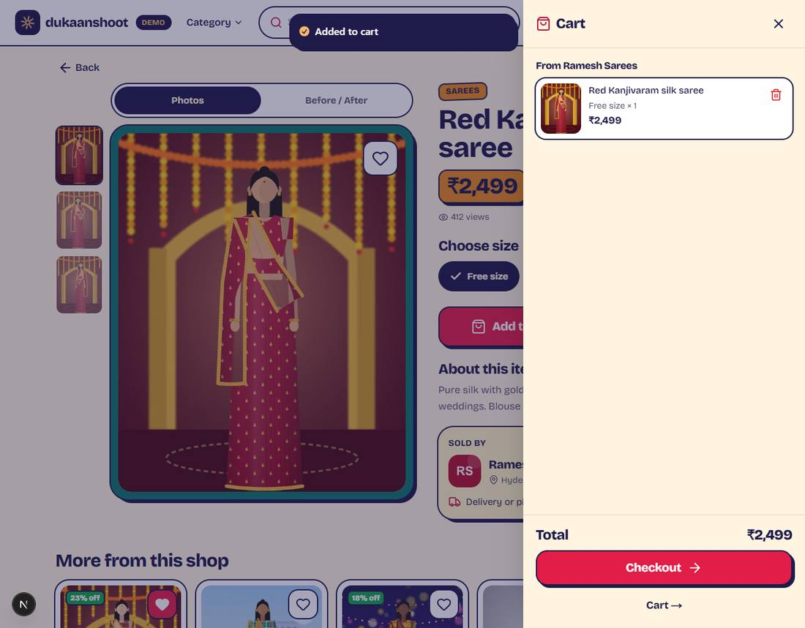 | 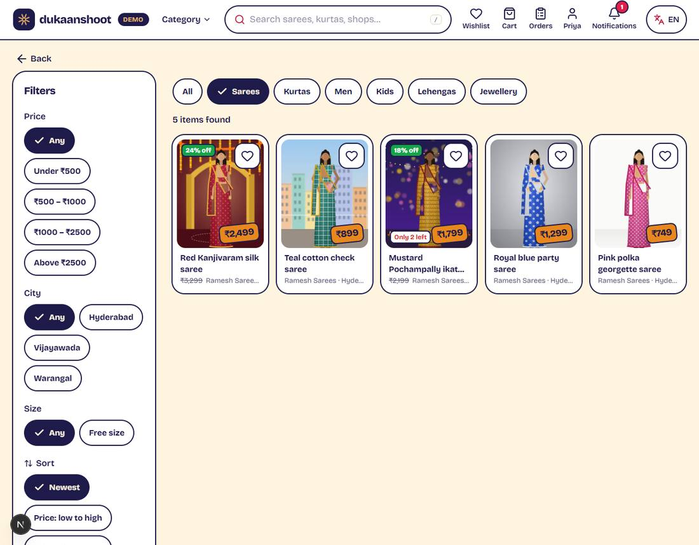 |

| Seller sidebar dashboard | Orders table | 3-panel photo studio | Tablet (icon rail) |
|---|---|---|---|
| 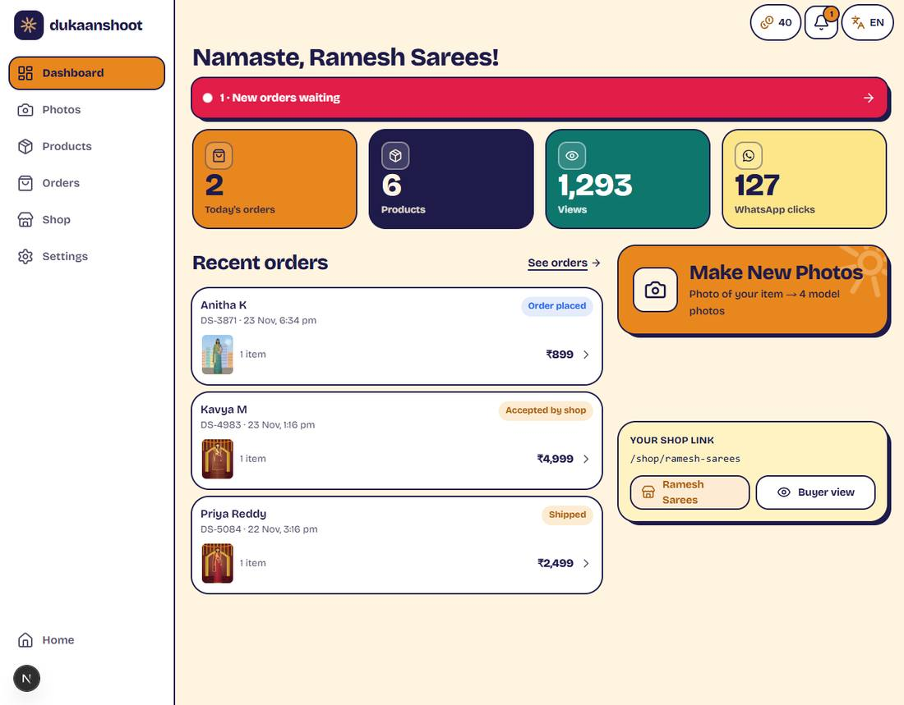 | 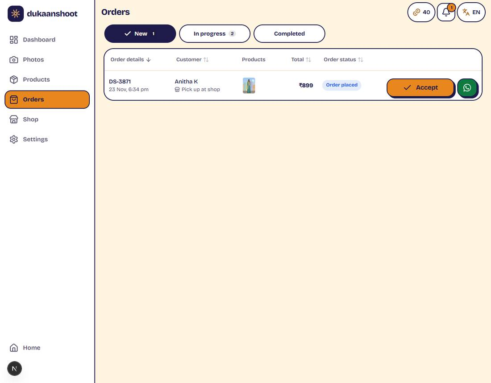 | 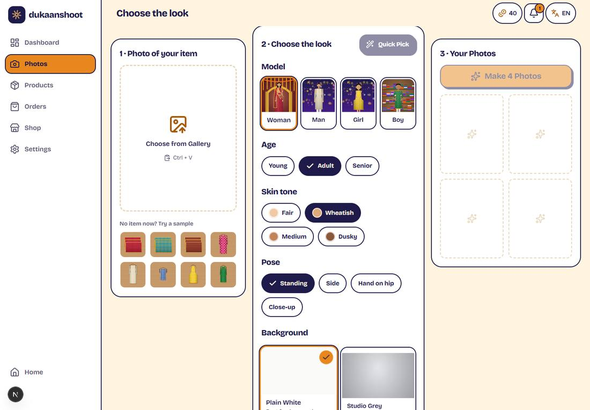 | 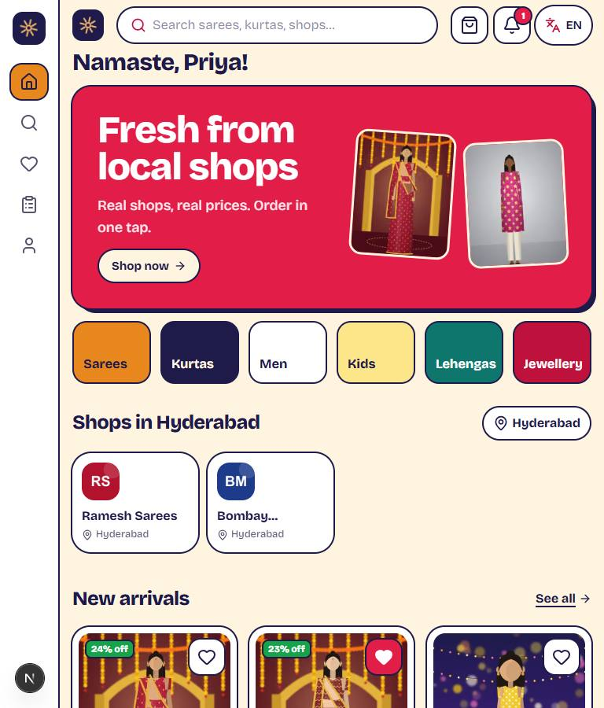 |

## How to demo it

**One device (zero setup):** open the app in **two browser windows side by side**. In the first, tap **Demo as Seller**; in the second, **Demo as Buyer**. Both share one marketplace stored on the device, and updates appear instantly in both windows (BroadcastChannel):

- An order placed by the buyer slides into the seller's Orders with a "ding".
- When the seller taps Accept → Packed → Shipped, the buyer's timeline moves live.
- A product the seller lists ("Make Photos" → "Sell this item") appears in the buyer's marketplace.

To start over, use **Profile → Reset demo data**.

**Two phones:** this needs the free Supabase setup below plus `npm run seed:supabase`. The demo buttons then sign in to shared cloud accounts, and updates travel between phones through Supabase Realtime.

## Quick start (local)

```bash
npm install
npm run dev          # http://localhost:3000  → tap "Try Demo"
```

To test on your phone on the same Wi-Fi, open `http://<your-PC-IP>:3000`. Camera capture and installing the app need **HTTPS**, so use the Vercel link for those.

Other scripts:

| Command | What it does |
|---|---|
| `npm run build && npm start` | production build |
| `npm run lint` / `npm run typecheck` | ESLint / TypeScript |
| `npm run assets` | re-renders the sample garments, sample result photos, background thumbnails and PWA icons in `public/` |

## Deploy free on Vercel

```bash
npx vercel login
npx vercel --prod
```

No environment variables are required for the demo. Vercel's free Hobby plan is enough. To change settings later, go to Vercel → Project → Settings → Environment Variables, then redeploy.

**Recommended:** set `APP_SECRET` to a long random string. It signs the simulated test payments.

## Environment variables

Every variable is documented in [`.env.example`](.env.example). Summary:

| Variable | Needed for | Default |
|---|---|---|
| `DEMO_MODE` | test-only payments, Demo badges, automatic fallback to demo photos | on without Supabase, off with it |
| `APP_SECRET` | signing simulated payment orders | dev value (change it) |
| `TRYON_PROVIDER`, `FASHN_API_KEY` | real AI photos (`TRYON_PROVIDER=real`) | mock |
| `NEXT_PUBLIC_SUPABASE_URL`, `NEXT_PUBLIC_SUPABASE_ANON_KEY`, `SUPABASE_SERVICE_ROLE_KEY` | Google / email login, cloud storage, server-side credits | off |
| `RAZORPAY_KEY_ID`, `RAZORPAY_KEY_SECRET`, `RAZORPAY_WEBHOOK_SECRET` | real Razorpay **test** checkout | simulated checkout |
| `CREDIT_PACKS` | pack prices (JSON, paise) | ₹49/10, ₹199/50, ₹499/150 |

### Optional: Supabase (Google + email login)

1. Create a free project at supabase.com.
2. Run [`supabase/migrations/0001_init.sql`](supabase/migrations/0001_init.sql), then [`0002_marketplace.sql`](supabase/migrations/0002_marketplace.sql), in the SQL editor. Together they create the tables, Row Level Security, the credit and order functions (stock-safe), Realtime publications, and the storage buckets.
3. Go to Authentication → Providers. Enable **Email** (magic link) and **Google** (paste your Google OAuth client ID and secret).
4. Go to Authentication → URL Configuration. Set Site URL to `https://<your-app>.vercel.app` and add `https://<your-app>.vercel.app/auth/callback` to the redirect URLs.
5. Add the three `SUPABASE` variables to Vercel and redeploy.
6. For the two-phone demo, choose emails and passwords for `DEMO_SELLER_*` and `DEMO_BUYER_*`. Put them in `.env.local` and run `npm run seed:supabase`. It creates both accounts, the 4 sample shops and 20 products with photos. Add the same `DEMO_*` variables to Vercel.

### Optional: Razorpay test mode

1. In the Razorpay Dashboard, switch to **Test Mode**, then go to API Keys and generate a key pair.
2. Add `RAZORPAY_KEY_ID` (`rzp_test_…`) and `RAZORPAY_KEY_SECRET`. While `DEMO_MODE=true`, live keys are refused.
3. For the webhook backup, go to Webhooks, add `https://<your-app>/api/payments/webhook` with the events `payment.captured` and `order.paid`, and set `RAZORPAY_WEBHOOK_SECRET`.

Test UPI ID: `success@razorpay`.

### Optional: real AI (FASHN)

FASHN has no free tier: you buy credits before you can create a key. Set `TRYON_PROVIDER=real` and `FASHN_API_KEY`. The app uses FASHN's **product-to-model** endpoint, which is in "Preview".

While `DEMO_MODE=true`, any FASHN failure falls back to demo photos automatically, and the results screen says so. That includes running out of credits (`429 OutOfCredits`), rate limits, outages and failed jobs. A demo never crashes.

## Architecture

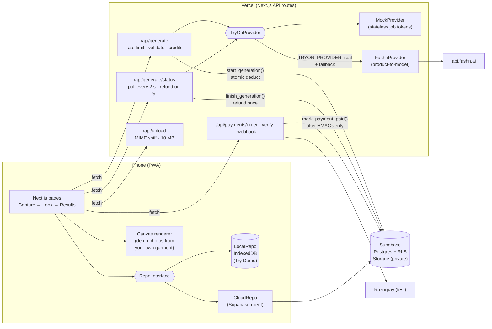

### Key design decisions

- **The AI provider can be swapped.** `src/lib/providers/types.ts` defines `TryOnProvider` with `generate()` and `getStatus()`, exactly as specified. The UI never knows which provider is running. To add Replicate or fal.ai, write a new class and switch on it in `providers/index.ts`.
- **Jobs are stateless.** A job token encodes what it needs, so polling works on any serverless instance with no job table or Redis.
- **The MockProvider is useful on its own.** For sample garments it returns the pre-made photos. For the shopkeeper's own photo it returns `render:` URLs, and the browser composites their actual garment onto an illustrated model. The colours and prints really come from their item, all offline and free.
- **Credits are atomic on real accounts.** `start_generation()` deducts and creates the job row in one Postgres transaction. `finish_generation()` refunds failed jobs exactly once. Users cannot write to `credits`: column privileges plus `SECURITY DEFINER` functions enforce it.
- **Payments are verified on the server before credits are added.** The checkout signature is an HMAC of `order_id|payment_id`. The amount and pack are read back from Razorpay, never trusted from the browser. The webhook is an idempotent backup.
- **Storage is private.** Supabase buckets are private, and users only reach their own folder (`<uid>/…`) through signed URLs.
- **Visual style: "Rangoli Grid".** Bold colour blocks (marigold, indigo, teal, butter, rose), 2px ink outlines with hard offset shadows, chunky Bricolage Grotesque type, sticker price tags and short pop-in motion. Everything is driven by the tokens at the top of `src/app/globals.css`: dark mode swaps the ink colour, and all motion turns off when the phone asks for reduced motion. Telugu and Hindi use the phone's own Noto fonts, with extra line-height so vowel signs never collide.
- **Demo accounts keep data on the device.** "Try Demo" stores everything in IndexedDB. Its credit wallet lives on the phone, which is fine for a demo but not for real money.

### Folder map

```
src/
  app/                    pages (App Router) + API routes
    (main)/               home, gallery, credits, settings   (bottom nav)
    (flow)/create/        capture → look → results/[id]        (3-step flow)
    api/                  generate, status, upload, image-proxy, payments, account
  components/             app chrome, results viewer, shadcn-style ui/
  lib/
    art/                  illustration engine + sample garment list (shared with scripts/)
    providers/            TryOnProvider, MockProvider, FashnProvider, fallback
    client/               repos, job runner, canvas renderer, overlay, share, voice
    server/               env, rate limit, validation, Razorpay
messages/                 en.json, te.json, hi.json
supabase/migrations/      schema + RLS + functions
scripts/generate-assets.mjs
```

## Using real photos in the demo

The sample garments and their "results" are illustrations, rendered by `npm run assets`. To make a demo look photographic:

1. Generate real photos once, for example with a few FASHN credits.
2. Replace the files in `public/samples/garments/` and `public/samples/results/`. Keep the same file names: `<sample-id>-1.jpg` … `-4.jpg`.

The app needs no other change.

## Routes

| Who | Path | Notes |
|---|---|---|
| Everyone | `/market`, `/search`, `/product/[id]`, `/shop/[slug]`, `/cart` | No login needed to browse or fill a cart |
| Logged in | `/checkout`, `/wishlist`, `/account/orders/*`, `/notifications` | Guarded by `middleware.ts` |
| Sellers | `/seller/*` (dashboard, create, products, orders, shop, credits, settings) | Sellers only. "Buyer view" switches to the marketplace |

Data goes through one `MarketStore` interface (`src/lib/market/types.ts`) with two implementations:

- **`LocalMarket`** stores everything on the device (IndexedDB + BroadcastChannel).
- **`CloudMarket`** uses Supabase. Postgres functions handle `place_order` (locks rows and reduces stock), `set_order_status` and `cancel_order` (both restore stock on cancel or reject). RLS lets sellers read only their own shop's orders, and Realtime delivers the live updates.

## Known limits of the demo build

- **Single device without Supabase.** The free demo's marketplace lives on one device. A two-phone demo needs Supabase (migration `0002_marketplace.sql` + `npm run seed:supabase`). The Supabase paths have not yet been run against a live project.
- **Garment detection is a guess.** The garment-type "auto-detect" is a simple offline guess; the shopkeeper confirms it with big chips.
- **Rate limiting is per instance.** The rate limiter lives in memory, so on Vercel it is per serverless instance.
- **Voice input is Chrome on Android.** It uses the browser's Web Speech API; other browsers are asked to tap the options instead.
- **Card-to-product transition.** The image expands into the product page using the browser's View Transitions API, because Framer Motion's `layoutId` can't animate across App Router page changes. Browsers without View Transitions just navigate.
- **Celebrations aren't Lottie.** The first-product and first-sale celebrations use built-in SVG/Framer animations plus confetti, not LottieFiles files.
- **Lighthouse:**
  - Mobile (simulated slow 4G): Accessibility, Best Practices and SEO are 100 on the marketplace pages. Performance is 87–89; the remaining cost is the React/Next framework JavaScript.
  - Desktop: market page Performance 98, Accessibility 100.
- **Responsive testing** was done in headless Chrome at 360, 390, 430, 768, 1024, 1280, 1440 and 1920px. Every main screen was checked for sideways scrolling and for fixed bars leaving the bottom edge. It has **not** been tried on a real Android phone yet.
